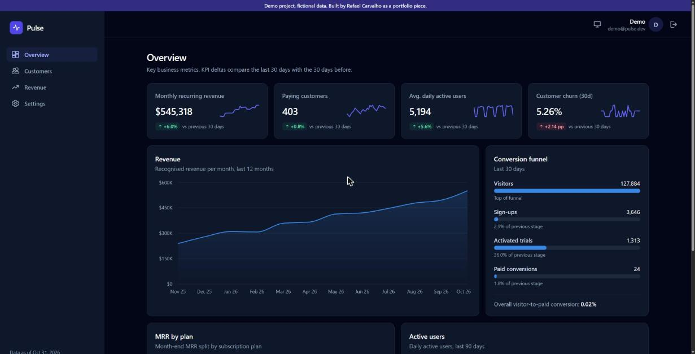

# Pulse Analytics: SaaS Dashboard

A production-style analytics dashboard for a fictional SaaS business, built with React 18, TypeScript (strict) and Tailwind CSS.

> **Demo project. All data is fictional** and generated in the browser from a fixed seed.

**Live demo:** https://rafaelcarvalho.dev/saas-dashboard/ (any email and password will sign you in)

## Features

- **Overview**: KPI cards with period-over-period deltas and sparklines, a revenue area chart, MRR by plan as a stacked bar chart, a daily active users line chart and a conversion funnel.
- **Customers**: a TanStack Table with column sorting, multi-term search that ignores accents, status and plan filters, pagination (10/25/50 rows), CSV export of the filtered rows, and a detail drawer for each customer with focus trap, Escape to close and focus restore.
- **Revenue**: a 7d / 30d / 90d / 12m range picker that updates every KPI and chart. Data is bucketed by day, week or month depending on the range, and each range is compared with the period before it.
- **Settings**: a profile form built with react-hook-form and zod (inline errors, `aria-invalid`, dirty tracking, reset), a light / dark / system theme switch and a "simulate API errors" switch for testing failure states.
- **Auth**: a fake login (any credentials work). The session is kept in `localStorage` and protected routes redirect to `/login`, then return you to the page you asked for.
- **Every data view has a state**: loading skeletons, empty states and error states with a retry button.
- **Accessibility**: skip link, landmarks, visible focus rings, keyboard-operable radio groups (arrow keys), `aria-sort` on table headers, live regions for filter results and saves, and charts with legends so color is never the only cue.
- **Responsive**: off-canvas sidebar on mobile, and tables scroll inside their own container.
- **Dark mode**: follows the system setting by default, and the theme is applied before first paint so the page never flashes the wrong theme.

## Tech stack

| Concern | Choice                                                                                       |
| ------- | -------------------------------------------------------------------------------------------- |
| Build   | Vite 5, `base: './'` so the build works from any subfolder                                   |
| UI      | React 18, TypeScript 5 (strict, `noUncheckedIndexedAccess`)                                  |
| Styling | Tailwind CSS 3, `class`-based dark mode                                                      |
| Routing | React Router 6 (`HashRouter`, routes loaded with `React.lazy`)                               |
| Charts  | Recharts                                                                                     |
| Tables  | TanStack Table v8                                                                            |
| State   | Zustand (with the `persist` middleware for session and settings)                             |
| Forms   | react-hook-form + zod                                                                        |
| Dates   | date-fns                                                                                     |
| Quality | Vitest, React Testing Library, ESLint 9 (typescript-eslint, jsx-a11y, react-hooks), Prettier |

All dependency versions are pinned exactly in `package.json`.

## Architecture

```
src/
  data/          seeded data generator, analytics (aggregation) and the fake async API
  store/         Zustand stores: auth session, theme, settings
  hooks/         useAsync: loading/error/retry, ignores stale responses
  components/
    layout/      app shell, sidebar, route guard, page header, Suspense fallback
    ui/          Button, Badge, Drawer, Segmented (radiogroup), KPI card, states
    charts/      Recharts wrappers, shared tooltip and legend, funnel
  features/
    customers/   table, filters (pure function), detail drawer
    settings/    zod schema and profile form
  pages/         one lazily loaded module per route
```

- **Deterministic data.** `generateDataset()` uses a seeded Mulberry32 PRNG to create 500 customers over two years. It builds daily metrics from those customers using difference arrays, so MRR, new MRR, churned MRR and paying customers always match the customer list. The tests check this.
- **Fake API layer.** `data/api.ts` wraps the aggregations in promises with 350 to 900 ms of simulated latency and an error switch. The UI only talks to this layer, so swapping in a real REST or GraphQL backend means changing one file.
- **Pure logic, thin components.** Filtering, bucketing, KPI deltas and CSV escaping are plain functions with unit tests. Components only wire them to the UI.
- **Code splitting.** Each route is its own chunk, and Recharts is only downloaded by the pages that draw charts.
- **Theming.** The chart series colors are CSS custom properties with separate values for the light and dark surfaces, and each plan keeps the same color on every chart.

## Screenshots



Live demo with every page: https://rafaelcarvalho.dev/saas-dashboard/ (any email and password sign you in).

## Getting started

Requires Node 18+ (developed on Node 24).

```bash
npm install
npm run dev          # start the dev server
npm test             # Vitest in watch mode (use `npm test -- --run` for a single run)
npm run lint         # ESLint, zero warnings allowed
npm run format       # Prettier
npm run build        # type-check + production build into dist/
npm run preview      # serve the production build locally
```

## Tests

29 tests in 8 files cover:

- the data generator (determinism, lifecycle consistency, MRR reconciliation)
- the analytics bucketing per range and the funnel
- customer filtering (search, accents, combined filters)
- the customers table (pagination, search, empty state, sorting, keyboard selection)
- profile form validation and submit/error flows
- the auth guard and the full login redirect flow
- page smoke tests (overview render, range switching, API error with retry)
- CSV escaping and the seeded RNG

## Known limitations

- There is no backend. Data, the session and profile edits live only in the browser.
- The login is cosmetic and must not be used as a model for real authentication.
- The Recharts chunk is about 110 kB gzipped. It is lazy-loaded, but a lighter chart library could shrink it.

---

Built by [Rafael Carvalho](https://rafaelcarvalho.dev).
